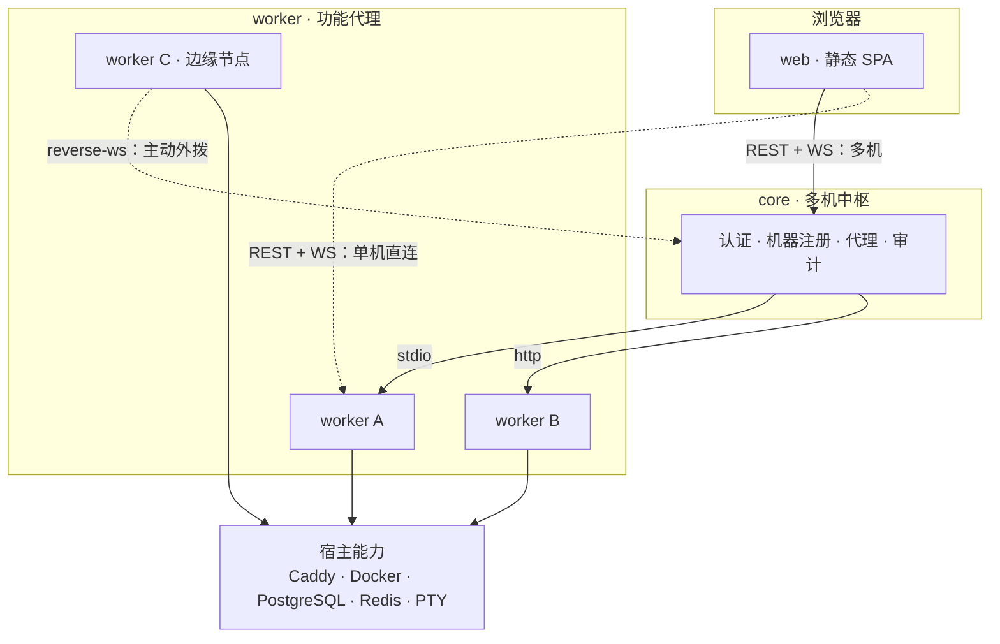

<div align="center">

# MPanel

轻量、三端分离的服务器管理面板

[](#)
[](#)
[](#)
[](LICENSE)

网站 · 证书 · 数据库 · 容器 · 文件 · 终端 · 计划任务 · 边缘节点

</div>

---

MPanel 把「一台机器」和「一片机器」拆成两件事：

- **worker** 是真正干活的代理，网站、证书、数据库、容器、文件、终端、计划任务全部在 worker 里实现；
- **core** 只做多机注册、认证、代理与聚合，自己不碰 Caddy、Docker 和文件系统；
- **web** 是纯静态 SPA，既能直连单个 worker（单机面板），也能连一个 core（多机面板），还能同时保存多个后端来回切换。

因为功能都在 worker，部署可以很小；因为 core 只做转发，机器可以在 NAT 后面；因为前端只是静态文件，它可以放在任何一台你喜欢的机器上。

## 为什么是 MPanel

- **三端独立部署。** `web` / `server/core` / `server/worker` 各有自己的构建产物与容器镜像，谁挂了都不牵连另外两个。
- **一套接口，两种拓扑。** worker 与 core 提供同一套 `/api/v1`；core 只是多一层 `/machines/:id/proxy`，前端切换 basePath 就能在「直连单机」和「多机管理」之间切换，不需要两套 UI。
- **三种传输，按网络环境选。** stdio（core 拉起进程）、http（worker 暴露端口）、reverse-ws（worker 主动外拨），共用同一套隧道帧协议与请求处理器。
- **边缘节点。** 参考 Portainer Edge 的做法：NAT 后的机器用一次性入网密钥自助注册；离线期间排队的作业在重连后串行补跑。
- **能力显式降级。** 没装 Caddy / Docker / PostgreSQL / Redis 不会 500，而是 `UNAVAILABLE` + 安装提示；前端直接告诉你缺什么。
- **现代化网站管理。** 结构化站点模型 → 生成 `sites.d/*.caddy` → `caddy validate` → 原子替换 → reload，失败自动回滚；证书直接读 Caddy 数据目录并展示到期时间。

## 功能

| 模块 | 一期能力 |
|---|---|
| **网站与证书** | 静态站 / 反向代理 / PHP-FPM / 重定向；多域名、TLS 模式（auto/internal/off/dns）、额外响应头、基础认证、重定向规则；Caddyfile 预览、导入现有配置、apply 校验与失败回滚；证书列表与 30/14/7 天到期筛选 |
| **数据库** | 仅 PostgreSQL 与 Redis：连接档案（AES-256-GCM 加密落盘、列表脱敏）、连通性测试、版本与运行统计、备份/恢复；查询界面通过 iframe 嵌入外部 **dbx**，用一次性 handoff 票据交接 |
| **容器** | Docker CLI 适配：容器列表/启停/重启/删除/exec、实时日志、stats；镜像列表与拉取；compose 编排（stack）识别、up/down/restart/pull、compose 文件查看与编辑 |
| **文件** | 多根沙箱（realpath 前缀校验、拒绝符号链接逃逸）、上传/下载（断点 Range）、在线编辑、重命名/复制/移动、chmod、回收站、tar.gz 归档与解压、文件名与内容搜索 |
| **终端** | PTY 多会话（`node-pty` 可选，缺失时降级为无 PTY 的管道），WS 凭一次性 ticket，尺寸同步、滚动缓冲、断线提示 |
| **计划任务** | cron 表达式校验与未来 5 次运行预览、立即执行、启停、超时与并发策略、运行历史（退出码 + 输出尾部） |
| **边缘节点** | 入网密钥（有效期/次数/分组）、自动注册、节点快照（系统/资源/版本）、离线异步作业（快照 / 跑任务 / 应用站点）、按组筛选 |
| **多机与认证** | 三种传输、机器启停与 secret 轮换、健康与能力聚合、会话登录（scrypt + HttpOnly Cookie + 一次性 WS ticket）、API Token、审计日志 |

界面页面：概览、网站、证书、数据库、容器、文件、终端、计划任务、机器、边缘节点、设置。仓库暂不含截图，启动后在浏览器查看。

## 架构



| 模式 | 链路 | 适合 |
|---|---|---|
| **单机直连 worker** | 浏览器 → worker:8787 | 一台机器、最少组件；浏览器保存 worker token |
| **core + 多机** | 浏览器 → core:8790 →（stdio / http / reverse-ws）→ 各 worker | 多台主机、集中登录与审计 |
| **边缘节点** | 内网 worker 主动拨号 core 的 `/ws/worker` | NAT/防火墙后、只允许出站的机器 |

> core 是单点：会话与机器状态在本地 JSON，不支持多副本。需要高可用时请在外层做反向代理与备份。

## 快速开始

### 方式一：Docker（core + worker 编排）

```bash
git clone https://github.com/Sakana-1314/MPanel.git
cd MPanel

cp deploy/compose.env.example deploy/compose.env
# 至少设置 MPANEL_PUBLIC_URL 与 WORKER_HTTP_TOKEN（生成：node server/worker/dist/index.js token generate --length 32）
docker compose -f deploy/docker-compose.yml --env-file deploy/compose.env up -d --build
```

打开 `http://127.0.0.1:8790`。首次启动如果没有设置管理员密码，core 会在日志里给出一枚一次性 bootstrap token，用它完成初始化。

CI 会构建并推送三个镜像（固定 tag：`latest` 与 `v<version>`），也可以直接使用：

```bash
docker pull ghcr.io/sakana-1314/mpanel-web:latest
docker pull ghcr.io/sakana-1314/mpanel-core:latest
docker pull ghcr.io/sakana-1314/mpanel-worker:latest
```

> 镜像由 GitHub Actions 构建；本仓库开发机没有 Docker，Dockerfile 与 systemd 单元未在本机构建验证，首次部署请留意构建日志。

### 方式二：源码（5 分钟）

```bash
pnpm install
pnpm build

# 1. 生成 worker token，并写入 ./mpanel-home/config.json
node server/worker/dist/index.js token generate --length 32 --write --home ./mpanel-home

# 2. 启动 worker（http 传输，127.0.0.1:8787）
export MPANEL_HOME=./mpanel-home
node server/worker/dist/index.js serve

# 3. 另开终端启动 Web 开发服务器
pnpm --filter @mpanel/web dev     # http://localhost:5173
```

在浏览器里新增一个「worker」连接：地址 `http://127.0.0.1:8787`，token 用第 1 步生成的值。需要多机时再启动 core：

```bash
export MPANEL_CORE_HOME=./mpanel-core-home
export MPANEL_LISTEN=127.0.0.1:8790
export MPANEL_PUBLIC_URL=http://127.0.0.1:8790
export MPANEL_ADMIN_USER=admin
export MPANEL_ADMIN_PASSWORD='change-this-password'
node server/core/dist/index.js serve
```

`pnpm dev` 会并行启动 worker / core / web 三个 watcher；首次上手建议按上面的分步命令启动。

### 关键默认值

| 进程 | 默认监听 | 说明 |
|---|---|---|
| worker | `127.0.0.1:8787` | `MPANEL_LISTEN` 或 `MPANEL_HOST` + `MPANEL_PORT`；`0` 表示随机端口 |
| core | `127.0.0.1:8788` | 代码默认；仓库示例与部署文件统一显式设为 `8790` |
| web dev | `127.0.0.1:5173` | Vite 默认；跨域调试时把该 origin 加进 worker 的 `MPANEL_CORS_ORIGINS` |
| 健康检查 | `GET /healthz` | core/worker 均免认证，只表示进程存活 |

## 边缘节点接入

参考 Portainer Edge 的交互，但只保留最必要的四件事：入网、分组、快照、离线作业。

1. 在 core 的「边缘节点」页新建**入网密钥**（可设分组、有效期、最大使用次数）。
2. 在目标机器上启动 worker，只需要出站网络：

```bash
# Linux / macOS
MPANEL_TRANSPORT=reverse-ws \
MPANEL_CORE_URL=https://panel.example.com \
MPANEL_EDGE_KEY=mpedge_xxxxxxxx \
MPANEL_HOME=/var/lib/mpanel/worker \
node server/worker/dist/index.js serve

# Windows PowerShell
$env:MPANEL_TRANSPORT="reverse-ws"
$env:MPANEL_CORE_URL="https://panel.example.com"
$env:MPANEL_EDGE_KEY="mpedge_xxxxxxxx"
$env:MPANEL_HOME="C:\ProgramData\mpanel\worker"
node server/worker/dist/index.js serve
```

3. 节点会自动出现在列表里（`edge=true`），core 立即取一次系统快照，之后每 5 分钟刷新。
4. 需要它做点什么而它恰好离线时，直接建**边缘作业**：`snapshot`、`run-task`、`apply-site`。作业在节点重连后按创建顺序串行执行，结果与 HTTP 状态回填到列表里。

入网身份保存在 `MPANEL_HOME/edge.json`（0600），重启后复用；密钥被吊销或次数用尽时，新的入网请求会得到 `FORBIDDEN`。

## 环境变量

完整模板：worker 见 [`.env.example`](.env.example) 与 [`deploy/env/worker.env.example`](deploy/env/worker.env.example)，core 见 [`deploy/env/core.env.example`](deploy/env/core.env.example)，web 编译期见 [`web/.env.example`](web/.env.example)。

> Node 不会自动读取 `.env`：可用 `node --env-file=.env ...`、`export`、systemd `EnvironmentFile=` 或 Docker `env_file`。
> **worker 与 core 不要共用同一个 env 文件**：两边都读 `MPANEL_HOME` / `MPANEL_LISTEN` 一类的变量，共用会让它们抢同一个端口或状态目录。

### worker（常用）

| 变量 | 默认 | 说明 |
|---|---|---|
| `MPANEL_HOME` | `~/.mpanel` | 状态根：`config.json`、`state/`、`logs/`、`caddy/`、`files/`、`backups/`、`edge.json` |
| `MPANEL_TRANSPORT` | `http` | `http` / `stdio` / `reverse-ws` |
| `MPANEL_LISTEN` | `127.0.0.1:8787` | `host:port`；优先于 `MPANEL_HOST`/`MPANEL_PORT` |
| `MPANEL_TOKEN` | 无 | `serve` 必需；REST `Authorization: Bearer`，WS 用 ticket |
| `MPANEL_CORS_ORIGINS` | 空（拒绝跨域） | 浏览器直连 worker 时必须填前端 origin，逗号分隔 |
| `MPANEL_FILES_ROOTS` | `files=$MPANEL_HOME/files` | `name=绝对路径[,...]`，文件沙箱的允许根 |
| `MPANEL_SITES_ROOTS` | 文件根 + `$MPANEL_HOME/sites` | 站点 `root` 白名单 |
| `MPANEL_CADDY_BIN` / `MPANEL_CADDY_CONFIG_DIR` / `MPANEL_CADDY_DATA_DIR` | `caddy` / `$MPANEL_HOME/caddy` / `…/data` | Caddy 可执行文件、受管配置目录、证书数据目录 |
| `MPANEL_DOCKER_BIN` | `docker` | Docker CLI；容器模块全部经参数数组调用，不拼 shell |
| `MPANEL_PG_DUMP_BIN` / `MPANEL_PSQL_BIN` / `MPANEL_REDIS_CLI_BIN` | 同名命令 | 数据库备份恢复工具 |
| `MPANEL_DBX_URL` 相关 | — | dbx 由前端 `VITE_DBX_URL` / `config.json` 配置，worker 只发 handoff 票据 |
| `MPANEL_EDGE_KEY` | 无 | 边缘入网密钥；与 `MPANEL_CORE_URL` 一起启用自助注册 |
| `MPANEL_CORE_URL` | 无 | reverse-ws / 边缘模式的 core 地址（`http(s)://` 或 `ws(s)://`） |
| `MPANEL_MACHINE_SECRET` | 无 | 入网后由 core 一次性下发并持久化到 `edge.json`，重连复用 |
| `MPANEL_SECRET_KEY` | 自动生成 | 32 字节密钥（base64/hex）；未设置时写 `$MPANEL_HOME/secrets.key`（0600） |

### core（常用）

| 变量 | 默认 | 说明 |
|---|---|---|
| `MPANEL_CORE_HOME` | `~/.mpanel-core` | 机器、会话、审计、密钥 |
| `MPANEL_LISTEN` | `127.0.0.1:8788` | 对外监听；示例统一用 `8790` |
| `MPANEL_PUBLIC_URL` | — | 浏览器看到的地址；用于 reverse-ws / 边缘入网地址与 Cookie 默认值 |
| `MPANEL_WEB_DIST` | — | 指向 `web/dist` 时由 core 直接托管前端（SPA fallback） |
| `MPANEL_ADMIN_USER` / `MPANEL_ADMIN_PASSWORD` | — | 首次启动 seed 管理员；都不设则打印一次性 bootstrap token |
| `MPANEL_SESSION_SECRET` | 自动生成 | 会话签名密钥（0600） |
| `MPANEL_SECRET_KEY` | 自动生成 | 机器 token 等敏感字段的加密密钥 |
| `MPANEL_CORS_ORIGINS` | 同源 | 前后端分开部署时填前端 origin |
| `MPANEL_TRUST_PROXY` | `false` | 在反向代理后设为 `1`，否则登录限流拿到的是代理 IP |
| `MPANEL_ALLOW_STDIO` | `0` | 允许 core 以子进程方式拉起 worker（等价于在 core 主机执行命令） |

### web（编译期与运行时）

编译期（`web/.env`，会被打进 bundle，**不要放 token**）：

```bash
VITE_DEFAULT_BACKEND=https://panel.example.com   # 单个默认后端
VITE_DEFAULT_BACKEND_NAME=生产环境
VITE_DEFAULT_BACKEND_KIND=core
VITE_DBX_URL=https://dbx.example.com             # 可选
```

运行时（部署目录下的 `/config.json`，改完刷新即生效）：

```json
{
  "appName": "MPanel",
  "allowUserConnections": true,
  "dbxUrl": "https://dbx.example.com",
  "backends": [
    { "id": "prod-core", "url": "https://panel.example.com", "kind": "core", "label": "生产 core" }
  ]
}
```

`config.json` 是公开静态文件，**不能包含 token**；worker 连接所需的 token 由用户在界面里输入。

## 目录结构

```
MPanel/
├─ web/                       # Vite + React 前端（独立部署）
│  ├─ src/api/                # 契约镜像与请求封装
│  ├─ src/pages/              # 概览/站点/证书/数据库/容器/文件/终端/任务/机器/边缘
│  └─ public/config.json      # 运行时默认配置
├─ server/
│  ├─ shared/                 # core 与 worker 共享的协议、模型、zod 校验（构建期）
│  ├─ core/                   # 多机中枢：认证、机器注册、代理、审计
│  └─ worker/                 # 功能代理：六模块 + 三种传输 + 边缘入网
├─ scripts/
│  ├─ check.mjs               # 类型检查 + web 构建门禁
│  └─ smoke.mjs               # 真实进程端到端
├─ deploy/                    # Dockerfile / compose / systemd / 反代示例
├─ docs/                      # 架构、API 契约、隧道协议、运维手册
└─ .github/workflows/         # 校验 + 镜像构建
```

## 开发与门禁

```bash
pnpm install
pnpm dev                 # shared 构建 + worker/core/web 并行 dev
pnpm typecheck           # 全仓类型检查
pnpm build               # server 构建 + web 生产构建

node scripts/check.mjs   # 确定性门禁：CHECK: PASS / CHECK: FAIL
node scripts/smoke.mjs   # 端到端：SMOKE: PASS <n> checks
```

- `check.mjs` 覆盖全仓类型检查、前端生产构建、契约类型镜像与若干静态禁令。
- `smoke.mjs` 用真实 `dist` 进程与临时 `MPANEL_HOME` 跑：worker 直连、文件沙箱越界、站点生成与 apply 降级、任务调度与立即执行、容器/数据库能力降级、终端 WS、core 三种传输代理、审计，以及边缘入网与离线作业。
- GitHub Actions：PR/main 跑 `校验`；main、`v*` tag、手动触发跑 `镜像构建`（web/core/worker → GHCR，固定 tag）。
- Windows 上不能直接 spawn `pnpm`/`npm`（`.cmd` 会 ENOENT），脚本内统一用 `node` 调 JS；人工执行用 Bash。

## 安全

- 所有 `/ws` 必须凭一次性 ticket 或 token；worker token 用常量时间比较。
- core 登录使用 scrypt 哈希、HttpOnly + SameSite Cookie、登录限流与审计；支持 API Token 与机器级授权。
- 文件模块所有入口先 realpath 再校验允许根前缀，拒绝 `..`、符号链接逃逸与 Windows 保留名；删除进回收站。
- 外部命令一律 `execFile`/`spawn` 参数数组，不拼接 shell 字符串；用户输入进入 Caddyfile 前校验/转义。
- 计划任务的命令本身就是 shell 串，属于**可信属主功能**：能登录面板的人等价于能在这台机器上执行命令。
- 容器内管理宿主需要额外挂载（如 `/var/run/docker.sock` 等于交出宿主 root），详见 `docs/operations.md`。

## 路线图

- 多用户与角色细分（当前 admin / operator）、每用户可见机器范围
- 文件与数据库的定时备份策略、导出到对象存储
- 站点模板与应用一键部署（不追求 1Panel 应用商店的规模）
- 监控历史（指标落库与简单图表）
- 边缘节点批量操作与分组成员管理

## 协作与贡献

- 协作方式、PR 合并门禁、SSH 签名提交、目录与接口约定见 [`AGENTS.md`](AGENTS.md)。
- 改动接口必须先改 [`docs/api-contract.md`](docs/api-contract.md)，再改代码与 `web/src/api/types.ts`。
- 必须走 PR：`gh pr create` → `校验` 全绿 → `gh pr merge --squash --delete-branch`。

## 文档

- [架构与降级策略](docs/architecture.md)
- [REST API v1 契约](docs/api-contract.md)
- [core↔worker 隧道协议](docs/protocol.md)
- [快速开始](docs/quickstart.md) · [运维手册](docs/operations.md)

## License

本仓库代码不开源，也不允许任何未经明确授权地使用。详见 [LICENSE](LICENSE)。
